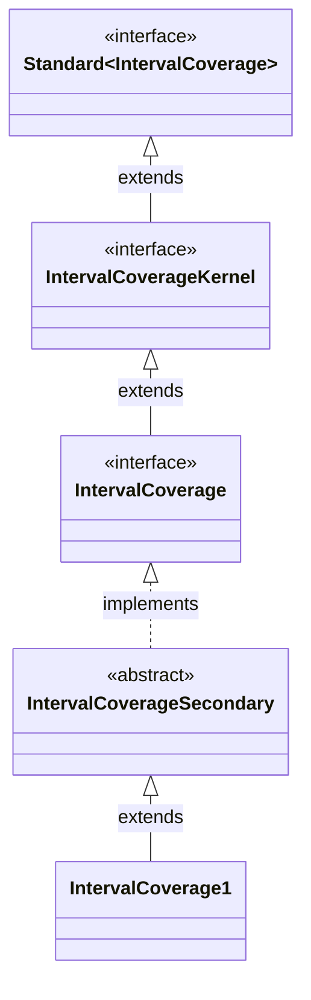

# Interval Coverage design

The abstract value is a set of covered positions. Every value has one
canonical decomposition into maximal contiguous spans. For example, covering
`[2, 5)` and then `[5, 7)` creates the same value as covering `[2, 7)` once.

The kernel changes that set through union and subtraction and exposes its
canonical spans through a count and a zero-based indexed query. Those four
operations let the secondary layer compute containment, the first sufficiently
long gap, total length, and the common object methods without reading or
modifying the representation. A scan checks the count before each indexed
read. A gap becomes a `Span` only after the minimum length check guarantees a
nonempty result.

The implementation stores the maximal spans in a private `ArrayList`.
Indexed reads and count take constant time. Covering and uncovering take time
and temporary list space proportional to the number of stored spans, independent
of their widths. Transferring ownership of the list and resetting the source
takes constant time. Immutable spans can be shared with clients without
exposing the list or allowing changes to coverage.

Storing one entry per covered position would grow with the widths of the
spans. A linked list would make the kernel's indexed reads linear and cause
repeated traversal in the secondary operations. The array list fits this API
and the expected small number of boundaries in both clients.
